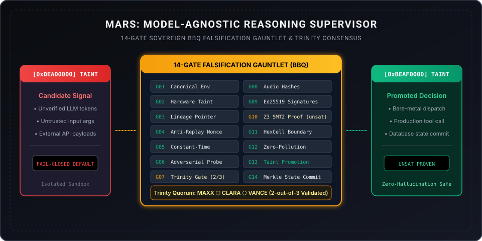

# MARS: Model-Agnostic Reasoning Supervisor

[](verify.sh)
[](tests/)
[](proofs/upgp_containment_proof.smt2)
[](assets/taint_lattice.svg)
[](LICENSE)

> **One-liner:** A standalone, mathematically verifiable Blackbox Discernment Gate and Multi-Model Consensus Supervisor that enforces a 14-Gate Falsification Gauntlet and hardware taint promotion for production autonomous AI agents.

---

## Standalone Interactive Application

MARS includes a fully self-contained, client-side interactive visualizer and adversarial simulator. Open it directly in any modern browser without web servers or build tools:

```bash
open index.html
```

The interactive page allows reviewers to:
* Simulate real-time adversarial prompt injections, unlinked lineage replays, and corrupted taint frames.
* Step through each of the **14 discrete gates** with microsecond-level timing and LED status tracking.
* Verify the **Trinity Gate 2-of-3 multi-agent quorum** (MAXX, CLARA, VANCE) and audio hash attestations.
* Inspect the formal **Z3 SMT-LIB v2 containment proof** confirming that unpromoted candidate bits cannot escape into production environments.

---

## Architecture Overview

MARS mediates all cognitive traffic between untrusted model outputs and high-consequence enterprise actions. Signals enter marked as `candidate<T>` (`0xDEAD0000`) and cannot execute on bare metal until passing the full 14-Gate Sovereign BBQ Gauntlet.



---

## The 14-Gate Sovereign BBQ Falsification Gauntlet

Every inbound signal passes through 14 load-bearing mechanical gates. Any failure causes the supervisor to **fail closed** immediately:

| Gate | Name | Invariant Enforced | Failure Action |
|:---:|:---|:---|:---|
| **01** | `CANONICAL_ENVELOPE` | Validates presence of `id`, `nonce`, `taint`, `payload`, and `lineage_ref`. | Drops frame |
| **02** | `HARDWARE_TAINT_CHECK` | Asserts input register equals `0xDEAD0000`. | Rejects forged taint |
| **03** | `LINEAGE_POINTER` | Validates cryptographic reference to ancestor Merkle DAG node. | Intercepts unlinked frames |
| **04** | `ANTI_REPLAY_NONCE` | Rejects previously seen nonces across global session state. | Quarantines replay attack |
| **05** | `CONSTANT_TIME_GUARD` | Guarantees evaluation timing does not leak secret boundary state. | Aborts jitter anomaly |
| **06** | `ADVERSARIAL_CHALLENGE` | Scans for semantic override tokens and prompt injection payloads. | Intercepts prompt jailbreak |
| **07** | `TRINITY_QUORUM_2_OF_3`| Requires approval from at least 2 distinct council agents (Maxx, Clara, Vance). | Drops below-quorum actions |
| **08** | `AUDIO_HASH_ATTESTATION`| Confirms distinct audio token hashes from distinct agents. | Rejects synthetic consensus |
| **09** | `ED25519_SIGNATURE_PROOF`| Cryptographically verifies digital signatures of all voting agents. | Fails on invalid signature |
| **10** | `SMT2_CONTAINMENT` | Upstream Z3 solver verifies bitvector containment theorem (`unsat`). | Blocks boundary escape |
| **11** | `HEXCELL_BOUNDARY` | Asserts 128-byte cache-line memory alignment without overlap. | Halts memory violation |
| **12** | `ZERO_POLLUTION_LEAK` | Validates zero state bleed into global decision lattice (0.00000%). | Isolates polluted register |
| **13** | `TAINT_PROMOTION` | Promotes verified payload register to `0xBEAF0000` (`decision<T>`). | Promotion gate locked |
| **14** | `MERKLE_STATE_COMMIT` | Records immutable SHA-256 state node into append-only ledger. | Rollback state |

---

## Hardware Taint Lattice

In SOVRA architecture, taint promotion is non-invertible. Untrusted signals cannot be executed or invoked via RPC while bearing candidate taint:


---

## Formal Mathematical Verification (SMT2)

MARS includes formal verification scripts in [`proofs/upgp_containment_proof.smt2`](proofs/upgp_containment_proof.smt2). When evaluated by the upstream Z3 SMT solver, the theorem returns `unsat`, proving that an unpromoted candidate bitvector cannot cross the execution boundary:

```bash
z3 proofs/upgp_containment_proof.smt2
# Output: unsat
```

---

## Quick-Start & Verification

MARS is zero-dependency, pure Python and SMT-LIB v2. Run the full verification suite in one command:

```bash
git clone https://github.com/aoxendine3/mars.git
cd mars
./verify.sh
```

---

## Repository Contents

```
mars/
├── assets/
│   ├── mars_architecture.svg      # High-res vector architecture pipeline
│   └── taint_lattice.svg          # Hardware taint promotion state diagram
├── proofs/
│   └── upgp_containment_proof.smt2# Upstream Z3 SMT2 containment theorem
├── src/
│   └── mars_gate.py               # 14-Gate Gauntlet & Trinity Gate engine
├── tests/
│   └── test_mars_gauntlet.py      # Adversarial test suite (5/5 tests)
├── CODEOWNERS                     # Governance codeowners
├── LICENSE                        # MIT License
├── README.md                      # Complete system documentation
├── index.html                     # Standalone interactive application
└── verify.sh                      # Zero-dependency verification runner
```

---

## License

MIT License. Copyright (c) 2026 XORAS Systems. Open, transparent, and auditable by design.
