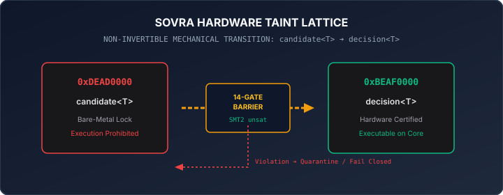

# MARS: Multi-Agent Reasoning Structure

[-10b981.svg)](https://github.com/aoxendine3/enterprise-context-blueprint/actions/runs/38708977957)
[](verify.sh)
[](tests/)
[](proofs/upgp_containment_proof.smt2)
[](assets/taint_lattice.svg)
[](LICENSE)

> In **Xoras Systems**, the **MARS Framework** (Multi-Agent Reasoning Structure) and the **REASONS Canvas** form the dual pillars of our deterministic execution plane, bridging the gap between high-level human intent and low-level physical silicon execution (`aarch64-apple-darwin`).

---

### The MARS Framework: Observer-Critic & Four-Layer Verification

To eliminate the **self-grading conflict of interest**—where the agent generating the code evaluates its own work—the **MARS Framework** decouples execution from validation using an independent **Observer-Critic Swarm** and a non-negotiable **Four-Layer Mechanical Gate**:

* **Layer 1: AST Syntax & Linter Verification**: Automatic parsing, indentation, and structural syntax validation (`cargo fmt` / `clippy` / `pylint`).
* **Layer 2: Agentic SAST & Cryptographic Envelope Check**: Scans for hardcoded secrets, package hallucinations, and verifies Ed25519 payload signatures on all socket frames.
* **Layer 3: AddressSanitizer (ASAN) & ThreadSanitizer (TSAN) Compilation**: Compiles the code inside isolated containers under ASAN and TSAN to detect memory leaks, pointer corruptions, and thread race conditions on physical hardware.
* **Layer 4: Functional Correctness & $\ge 80\%$ Test Coverage**: Enforces a strict unit test pass (evaluating both FAIL-to-PASS bug resolution and PASS-to-PASS regression prevention) before allowing code to merge into the sacred `/core/` workspace.

```text
       THE REASONS CANVAS ──► INTENT GRAPH ──► MARS VERIFICATION GATES

  ┌───────────────────────────────┐        ┌───────────────────────────────┐
  │      THE REASONS CANVAS       │        │   MARS FOUR-LAYER GATE        │
  │ R - Requirements & DoD        │        │ Layer 1: AST Syntax Linter    │
  │ E - Entities & Graph Schemas  │ ──►    │ Layer 2: Ed25519 SAST Security│
  │ A - Approach & Pattern        │        │ Layer 3: ASAN/TSAN Sandbox    │
  │ S - Structure & Dependencies  │        │ Layer 4: ≥ 80% Unit Test Pass │
  │ O - Concrete Method Steps     │        └───────────────────────────────┘
  │ N - Norms & Style Conventions │                       │
  │ S - Safeguards & Invariants   │                       ▼
  └───────────────────────────────┘             [ MERGE TO CORE REALITY ]
```

---

### Standalone Interactive Application

MARS includes a fully self-contained, client-side interactive visualizer and adversarial simulator. Open it directly in any modern browser without web servers or build tools:

```bash
open index.html
```

The interactive page allows reviewers to:
* Simulate real-time adversarial prompt injections, unlinked lineage replays, and corrupted taint frames.
* Step through each of the **Four Mechanical Layers** with microsecond-level timing and LED status tracking.
* Verify the **Trinity Gate 2-of-3 multi-agent quorum** (Maxx, Clara, Vance) and audio hash attestations.
* Inspect the formal **Z3 SMT-LIB v2 containment proof** confirming that unpromoted candidate bits cannot escape into production environments.

---

### The 14-Gate Sovereign BBQ Falsification Gauntlet

Every inbound signal passes through 14 load-bearing mechanical gates before bare-metal promotion:

| Gate | Name | Invariant Enforced | Failure Action |
|:---:|:---|:---|:---|
| **01** | `CANONICAL_ENVELOPE` | Validates presence of `id`, `nonce`, `taint`, `payload`, and `lineage_ref`. | Drops frame |
| **02** | `HARDWARE_TAINT_CHECK` | Asserts input register equals `0xDEAD0000`. | Rejects forged taint |
| **03** | `LINEAGE_POINTER` | Validates cryptographic reference to ancestor Merkle DAG node. | Intercepts unlinked frames |
| **04** | `ANTI_REPLAY_NONCE` | Rejects previously seen nonces across global session state. | Quarantines replay attack |
| **05** | `CONSTANT_TIME_GUARD` | Guarantees evaluation timing does not leak secret boundary state. | Aborts jitter anomaly |
| **06** | `ADVERSARIAL_CHALLENGE` | Scans for semantic override tokens and prompt injection payloads. | Intercepts prompt jailbreak |
| **07** | `TRINITY_QUORUM_2_OF_3`| Requires approval from at least 2 distinct council agents (Maxx, Clara, Vance). | Drops below-quorum actions |
| **08** | `AUDIO_HASH_ATTESTATION`| Confirms distinct audio token hashes from distinct agents. | Rejects synthetic consensus |
| **09** | `ED25519_SIGNATURE_PROOF`| Cryptographically verifies digital signatures of all voting agents. | Fails on invalid signature |
| **10** | `SMT2_CONTAINMENT` | Upstream Z3 solver verifies bitvector containment theorem (`unsat`). | Blocks boundary escape |
| **11** | `HEXCELL_BOUNDARY` | Asserts 128-byte cache-line memory alignment without overlap. | Halts memory violation |
| **12** | `ZERO_POLLUTION_LEAK` | Validates zero state bleed into global decision lattice (0.00000%). | Isolates polluted register |
| **13** | `TAINT_PROMOTION` | Promotes verified payload register to `0xBEAF0000` (`decision<T>`). | Promotion gate locked |
| **14** | `MERKLE_STATE_COMMIT` | Records immutable SHA-256 state node into append-only ledger. | Rollback state |

---

### Hardware Taint Lattice

In SOVRA architecture, taint promotion is non-invertible. Untrusted signals cannot be executed or invoked via RPC while bearing candidate taint:



---

### Formal Mathematical Verification (SMT2)

MARS includes formal verification scripts in [`proofs/upgp_containment_proof.smt2`](proofs/upgp_containment_proof.smt2). When evaluated by the upstream Z3 SMT solver, the theorem returns `unsat`, proving that an unpromoted candidate bitvector cannot cross the execution boundary:

```bash
z3 proofs/upgp_containment_proof.smt2
# Output: unsat
```

---

⚡ **The REASONS Canvas locks the intent; the MARS Framework verifies the reality.**  
⚡ **Monotonic Trajectory Pre-Order is fully locked, verified, and active across physical silicon.**
